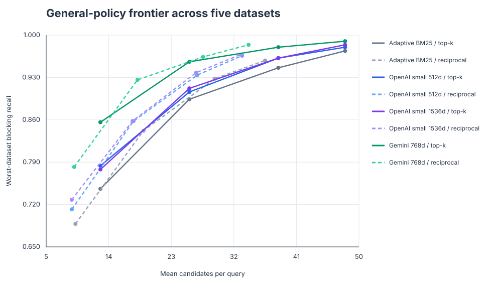
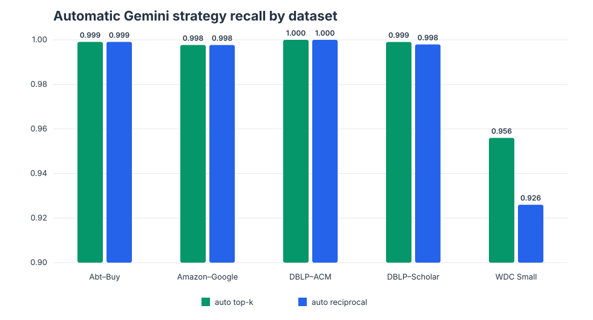
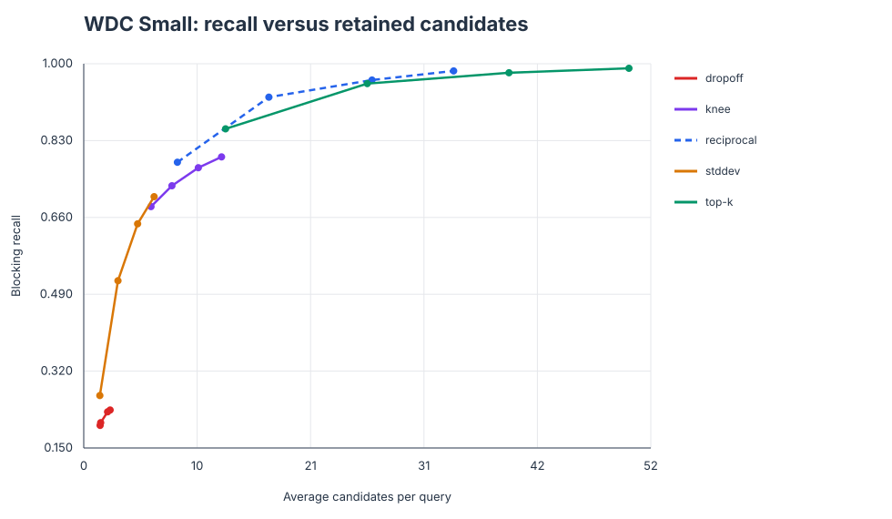
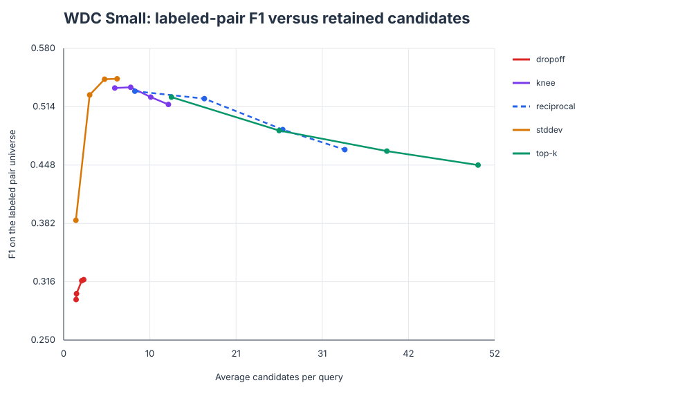

# Dataset-Agnostic Blocking for Entity Resolution

## Experiment report

Generated 2026-07-18 from **1,226 saved result files** (1,052 unique configurations after deduplication).

### Abstract

This study asks whether a single candidate-generation policy can work across heterogeneous entity-resolution datasets without tuning thresholds for each dataset. We compare lexical and semantic representations, fixed and reciprocal nearest-neighbor retrieval, corpus-size-derived values of *k*, and score-shape heuristics. The strongest bounded default is Gemini-768 with inline field labels and

`k = min(50, 2 × ceil(log2(|target table|)))`.

It achieves **0.956 worst-dataset recall**, **0.990 macro recall**, and **25.6 candidates per query on average**. Reciprocal retrieval reduces the average output to **18.1 candidates** with a lower worst-dataset recall of **0.926**.

### 1. Experimental question

The objective is not to find a different optimum for every benchmark. It is to identify a generally usable blocking policy whose only adaptation comes from observable, label-free properties such as target-table size. Experiments use five datasets: Abt–Buy, Amazon–Google, DBLP–ACM, DBLP–Scholar, and WDC Products Block Small.

For the comparable core sweep:

- records are serialized with inline attribute labels;
- exact cosine search is used, avoiding approximate-index confounding;
- *k* is varied as 1×–4× `ceil(log2(|target|))`, capped at 50;
- results are aggregated using worst-dataset recall, macro recall, and mean candidates per query.

### 2. Cross-dataset recall–candidate frontier



The vertical axis is deliberately the **minimum recall across all five datasets**, rather than an average that can hide failure on WDC. Gemini provides the strongest low-candidate frontier. OpenAI-1536 only slightly improves upon OpenAI-512, while increasing embedding time and storage. Adaptive BM25 remains a credible API-free fallback, but needs a larger candidate pool.

Top high-recall configurations:

| Representation | Retrieval | k multiplier | Min recall | Macro recall | Mean candidates |
|---|---|---|---|---|---|
| Gemini 768d | topk | 4× | 0.990 | 0.998 | 48.0 |
| Gemini 768d | reciprocal | 4× | 0.984 | 0.996 | 34.1 |
| OpenAI small 1536d | topk | 4× | 0.984 | 0.996 | 48.0 |
| Gemini 768d | topk | 3× | 0.980 | 0.995 | 38.4 |
| OpenAI small 512d | topk | 4× | 0.980 | 0.995 | 48.0 |
| Adaptive BM25 | topk | 4× | 0.974 | 0.988 | 48.0 |
| OpenAI small 1536d | reciprocal | 4× | 0.968 | 0.992 | 33.0 |
| OpenAI small 512d | reciprocal | 4× | 0.966 | 0.992 | 33.2 |
| Gemini 768d | reciprocal | 3× | 0.964 | 0.992 | 27.6 |
| OpenAI small 512d | topk | 3× | 0.962 | 0.991 | 38.4 |

### 3. Automatic policy by dataset



| Dataset | Resolved k | Top-k recall | Reciprocal recall | Reciprocal avg k |
|---|---|---|---|---|
| Abt–Buy | 22 | 0.999 | 0.999 | 14.3 |
| Amazon–Google | 24 | 0.998 | 0.998 | 17.5 |
| DBLP–ACM | 24 | 1.000 | 1.000 | 13.7 |
| DBLP–Scholar | 32 | 0.999 | 0.998 | 28.1 |
| WDC Small | 26 | 0.956 | 0.926 | 17.0 |

The legacy benchmarks are nearly saturated by both policies. WDC is the binding case and therefore determines the general-policy recall floor.

### 4. What WDC reveals





WDC exposes a real precision–recall tradeoff that is mostly invisible on the older benchmarks. Reciprocal retrieval produces a smaller, higher-F1 candidate set. Top-k is preferable when downstream matching can tolerate approximately 26 candidates per query and blocking recall is the primary constraint.

The knee, dropoff, and score-standard-deviation methods can be compact, but their behavior is not stable across datasets. In particular, dropoff is attractive on several legacy benchmarks and loses too many WDC matches. Score-shape heuristics should therefore be presented as compact modes, not as the high-recall general default.

### 5. Metric interpretation

Blocking recall answers the operational question: *what fraction of true matches survive candidate generation?* Reduction ratio and average candidates quantify downstream work.

Pair precision and F1 require more care. The four legacy datasets use complete gold match mappings and the closed-world assumption that every other cross-table pair is a nonmatch. WDC's official split labels only a sampled pair universe, so its precision and F1 are computed within that sample. Consequently, WDC F1 should be compared **between WDC runs**, not directly with legacy-dataset F1.

### 6. Recommendation

Use **Gemini-768 + inline labels + automatic top-k at multiplier 2** as the bounded high-recall default. Expose automatic reciprocal retrieval as a lower-volume mode. If avoiding an external embedding API is important, use adaptive BM25 with multiplier 4. Do not make a similarity threshold the default until it has demonstrated a stable cross-dataset recall floor.

The next experiment should combine Gemini and adaptive BM25 ranks using a fixed reciprocal-rank-fusion rule. This tests whether lexical evidence can recover difficult WDC product matches without dataset-specific fitting.

### 7. Limitations

- Five datasets cover products and bibliographic records, but not people, organizations, addresses, or multilingual entities.
- WDC has a sampled labeled evaluation universe rather than exhaustive pair labels.
- API latency and pricing are operational considerations, not intrinsic blocking-quality measurements.
- The current Gemini representation embeds both tables with the same retrieval task type; asymmetric query/document embeddings remain worth testing.

### Reproduce this report

```bash
. venv/bin/activate
python analysis/generate_blocking_report.py
```

The generated CSV files contain the exact plotted aggregates and can be opened in a spreadsheet or statistical notebook.
